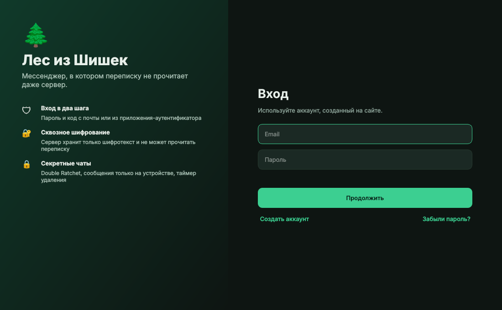
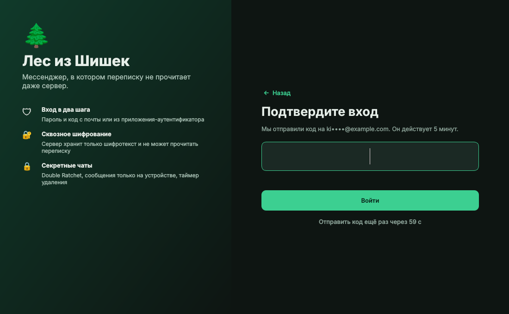
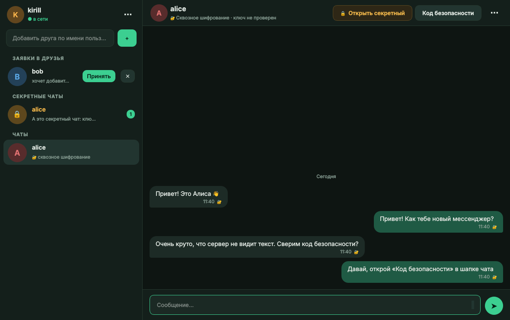
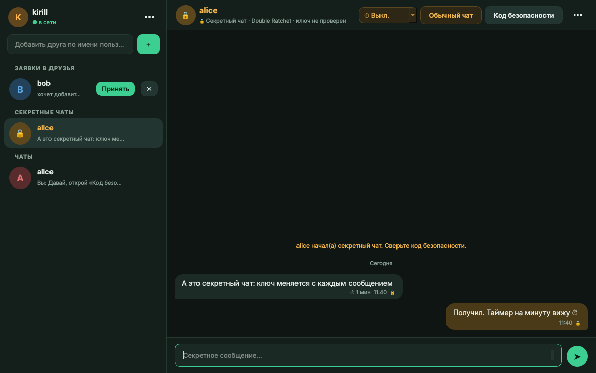
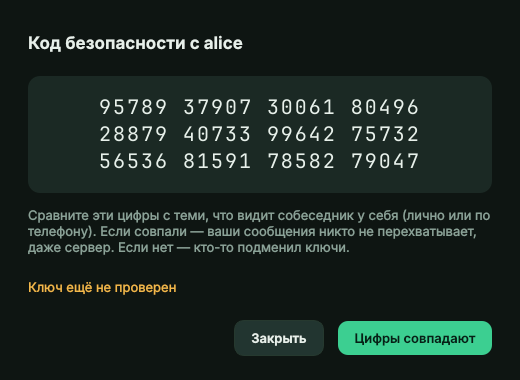
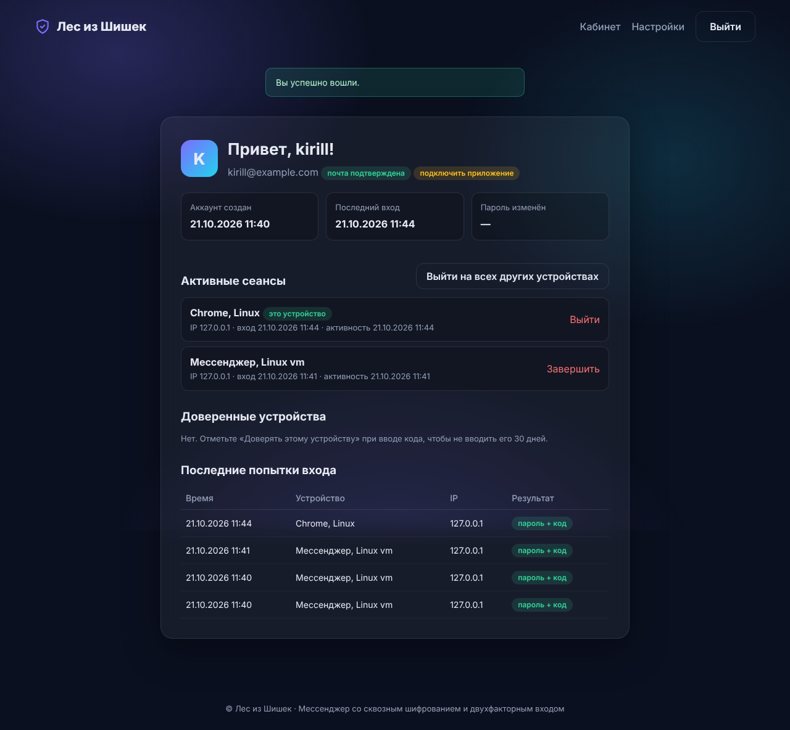

# Лес из Шишек

[](https://github.com/ShishaKirich/grpc-messenger/actions/workflows/ci.yml)
[](https://github.com/ShishaKirich/grpc-messenger/actions/workflows/codeql.yml)

Мессенджер на gRPC со сквозным шифрованием, секретными чатами и двухфакторным входом. В комплекте сайт — личный кабинет: регистрация, настройки 2FA, активные сеансы.

Проект вырос из курсовой работы (мессенджер на gRPC и PySide6) и отдельного проекта [2fa-auth-site](https://github.com/ShishaKirich/2fa-auth-site). Оба переписаны и объединены: один аккаунт, одна база пользователей, общие правила входа.

| | |
|---|---|
|  |  |
|  |  |
|  |  |

## Что умеет

**Аккаунт и вход**
- Регистрация на сайте с подтверждением почты. Пароли хранятся как Argon2id, новые пароли проверяются по базе утечек HIBP (наружу уходят 5 символов хеша).
- Вход и на сайт, и в мессенджер в два шага: пароль, затем код с почты, из приложения-аутентификатора (TOTP) или резервный код.
- Общий лимит неудачных попыток и журнал входов. Сеанс мессенджера виден в кабинете, его можно завершить оттуда, и клиент отключится.
- Восстановление и смена пароля, смена почты, доверенные устройства, письма о новых входах.

**Сообщения**
- Обычные чаты со сквозным шифрованием: X25519 + ChaCha20-Poly1305, подпись Ed25519. Сервер хранит только шифротекст и не может подделать сообщение.
- Секретные чаты: X3DH и Double Ratchet, как в Signal. Новый ключ для каждого сообщения, прямая секретность. Сервер удаляет сообщение сразу после доставки, переписка живёт только на устройстве. Таймер самоуничтожения.
- Код безопасности (60 цифр) для сверки ключей с собеседником. Предупреждение, если собеседник сменил устройство.
- Закрытые ключи лежат в зашифрованном хранилище на компьютере (Argon2id + ChaCha20-Poly1305).
- Друзья, заявки, блокировки. Все права проверяет сервер.

Подробнее: [как устроено шифрование](docs/CRYPTO.md), [модель угроз](SECURITY.md).

## Быстрый старт (Windows)

Нужен Python 3.10 или новее.

```bat
run.bat
```

Скрипт создаст `.venv`, поставит зависимости, сгенерирует `.env` со случайным `SECRET_KEY` и локальные TLS-сертификаты, затем запустит сайт, сервер и клиент.

1. Откройте http://localhost:8000 и зарегистрируйтесь. Почта по умолчанию в режиме `console`: коды печатаются в окне сайта.
2. Войдите в клиенте тем же email и паролем. Код придёт в окно сервера мессенджера.
3. Чтобы переписываться с самим собой, зарегистрируйте второй аккаунт и запустите `run_client.bat`.

## Запуск вручную (Linux, macOS)

```bash
python -m venv .venv && source .venv/bin/activate
pip install -r requirements.txt -r requirements-client.txt
cp .env.example .env            # впишите SECRET_KEY
python scripts/make_dev_cert.py # certs/ca.crt, certs/server.crt, certs/server.key

uvicorn web.main:app --port 8000          # сайт
python -m messenger_server.run_server     # сервер мессенджера (TLS, порт 50051)
python -m client                          # клиент
```

Для настоящей почты поставьте `MAIL_BACKEND=smtp` и заполните `SMTP_*` в `.env`.

## Архитектура

```
 ┌──────────── Клиент (PySide6) ────────────┐        ┌──────────── Сервер ─────────────┐
 │ client/ui      окна                      │  gRPC  │ messenger_server   вызовы,      │
 │ client/core    логика, секретные чаты    │◄──TLS─►│                    права, поток │
 │ e2e/           ключи и шифрование        │        │ auth_core          пароли, 2FA, │
 │ keystore       зашифрованные ключи       │        │                    коды, письма │
 └──────────────────────────────────────────┘        │ web                сайт-кабинет │
                                                     │ SQLite (WAL)                    │
                     Браузер ◄──── HTTP(S) ─────────►└─────────────────────────────────┘
```

- **Сервер** — `grpc.aio`, всё асинхронно. События приходят клиенту сразу через поток `Subscribe`, без опроса.
- **Шифрование** — только на клиенте. Сервер не импортирует пакет `e2e` и не видит закрытых ключей.
- **Сайт** — FastAPI, общая с сервером база и сеансы.

## Структура

```
auth_core/          общее ядро аккаунтов (пароли, коды, TOTP, письма, база)
web/                сайт — личный кабинет
messenger_server/   gRPC-сервер
e2e/                сквозное шифрование и секретные чаты
client/             клиент на PySide6
proto/              messenger.proto и сгенерированный код
scripts/            генерация proto и TLS-сертификатов для разработки
tests/              тесты сайта, сервера и шифрования
docs/               CRYPTO.md, CODE_GUIDE.md, скриншоты
```

Путеводитель по коду: [docs/CODE_GUIDE.md](docs/CODE_GUIDE.md).

## Тесты и проверки

```bash
pip install -r requirements-dev.txt
pytest -q
```

77 тестов: сценарии сайта, вход в мессенджер, права на сервере, переписка двух клиентов через настоящий сервер, подделка и повтор сообщений, прямая секретность.

На каждый push в CI запускаются тесты на Python 3.10 и 3.13, проверка актуальности сгенерированного proto, `bandit`, `pip-audit`, `gitleaks` и CodeQL.

## Что было в старой версии и что исправлено

| Было | Стало |
|---|---|
| Имя пользователя бралось из запроса, токен-заглушка | Сеанс с токеном, имя только из сеанса |
| SHA-256 без соли | Argon2id |
| Канал без шифрования | TLS |
| Клиент мог сам прислать «заявка принята» | Все переходы проверяет сервер |
| Сообщения в памяти и в логах открытым текстом | SQLite, только шифротекст, тексты не логируются |
| Вход по паролю | Пароль + код с почты или из приложения |

## Идеи на будущее

- Несколько устройств на аккаунт (Sesame, как в Signal).
- Одноразовые prekey для X3DH, чтобы усилить защиту первого сообщения.
- Вложения и голосовые с тем же шифрованием.
- Групповые чаты (Sender Keys или MLS).
- Вход по ключам доступа (WebAuthn/passkeys) на сайте.
- Docker Compose и развёртывание с настоящим сертификатом.

